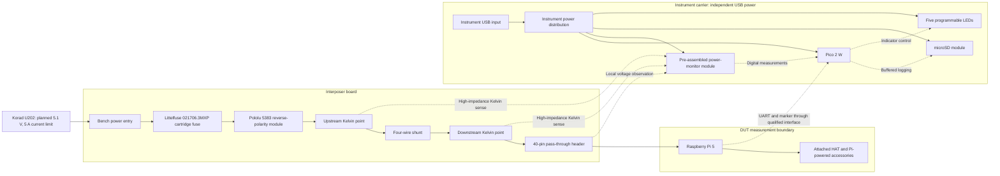

# Hand-soldered instrument architecture

Date: 2026-10-15; component decisions updated 2026-10-16. Status: approved by the owner in the project conversation ("i approve"), with subsequent authorization to reuse the earlier PCB geometry. Based on the approved [requirements](requirements.md). This is a functional design, not a schematic, validated circuit or fabrication release. At architecture approval, no parts had been selected. Subsequent prototype choices are Bourns MSR1-0R005F1 with its shunt hole exception, Adafruit 4682 for SPI storage, Littelfuse 021706.3MXP / Schurter 0031.8201.G / Pololu 5383 for protection with the holder hole exception, the Würth bench terminal / Samtec module header/socket set with their scoped hole exceptions, and the Adafruit 2223 Pi socket / JST-XH harness set with the Adafruit-only 40-hole exception. See the [provisional BOM](../hardware/bom.csv), [shunt qualification](msr1-qualification.md), [protection comparison](protection-options.md), [connection review](power-connector-options.md) and [Pi/harness review](pi-harness-connector-options.md). The owner subsequently selected one USB-powered SN74LV125AN for the three UART/marker signals; see [UART qualification](uart-interface-qualification.md). Qualification remains partial; monitor, carrier sockets, card power and detailed interface implementation remain open.

## Power flow and measurement boundary

Solid arrows show positive power flow. Dotted arrows show sensing or logical communication; UART is intended to be bidirectional. The high-current ground return and instrument reference connection are described below and omitted from the diagram for readability. Protection order is proposed here; its feasibility and fault behavior require component review. The owner-approved UART-bias network is the sole adopted exception to auxiliary-load exclusion: one Pi-RX pull-up and two Pi-TX/marker input pull-downs, omitted from this functional diagram, may load the DUT side. Active instrument supplies remain separate; see the [UART review](uart-interface-options.md).

The intended reported DUT load comprises the Pi, its cooler, the attached HAT and peripherals powered by the Pi, plus the explicitly approved UART-bias network. Independently powered peripherals and any alternative power paths must be declared for each experiment. The interposer's upstream power-path losses and other instrument loads remain outside the intended DUT energy boundary. Account separately for the voltage-observation location and downstream contact losses before making a Pi-energy accuracy claim.

| Path or load | Supply and current path | Treatment |
|---|---|---|
| Pi and Pi-powered accessories | Korad positive through fuse, protection and shunt, then the GPIO 5 V pins; dedicated high-current ground return to Korad negative | Included in DUT current |
| Pico, monitor, microSD and LEDs | Independent instrument USB supply and carrier power distribution | Excluded from DUT current |
| Protection bias or any interposer indicator, if needed | Instrument supply or a protected upstream bench-supply node; never downstream of the shunt | Excluded from DUT current; exact source and fault behavior require review |
| Active interface conditioning | Instrument-side 3.3 V supply; proposed input buffer and MOSFET gate-drive network | No Pi-powered buffer IC is authorized; exact parts, supply behavior and electrical qualification remain open |
| Approved UART bias exception | One 10 kΩ Pi-RX pull-up to Pi 3.3 V and two 100 kΩ pull-downs loading Pi TX/marker outputs | Included in reported DUT consumption by owner approval on 2026-10-16. Calculated nominal resistor-network allowance 1.3068 mW on the 3.3 V side before leakage, switching and Pi conversion loss; no fixed subtraction or complete worst-case claim |
| Kelvin and bus-voltage inputs | Signal observation only; monitor operating power comes from instrument USB | Input bias, leakage and loading require an explicit error budget; a significant auxiliary load on the sensed supply is unacceptable |

Use a high-side shunt so that the main DUT ground return contains no intentional sensing resistance. The two Kelvin connections terminate at the shunt's sensing terminals or independently reviewed sense points, not at arbitrary high-current tracks. Keep the pair coupled, short and separated from switching and high-current copper; the proposed board separation is approximately 10–20 cm.

The baseline is a non-isolated measurement system with an intentional instrument-to-DUT reference connection. Provide the Pi's high-current ground return directly on the interposer. Sense-reference wiring, carrier ground and USB wiring must not become the intended DUT power return. The exact reference connection and any additional ground conductors remain unresolved until the module and interface are reviewed; check parallel returns through USB, peripheral cables and bench earth connections. Independent USB power does not imply galvanic isolation.

## Voltage, current and energy meaning

The monitor observes shunt voltage and a downstream bus-voltage point. Current is derived from the selected, calibrated shunt resistance. Energy is the time integral of power derived from voltage and current, with conversion timing and integration error included in the accuracy budget. Resolution or bit count alone does not establish the approximately 1% energy-accuracy target.

The initial voltage observation point is the interposer's DUT-header power bus. This is not yet a claim to measure voltage at the Pi's internal supply rail. Header-contact loss and the voltage between the monitor reference and Pi ground must be accounted for. Select the bus-voltage reference and decide whether remote or differential voltage sensing is needed during module review. A module whose reference arrangement cannot meet the agreed error budget requires a revised sensing arrangement before schematic capture.

Define the final reported voltage point and included accessories before finalizing the energy acceptance test. If the measurement includes residual wiring or contact losses, document and bound them; do not label interposer-output energy as demonstrated Pi energy without resolving that distinction.

## Functional interfaces and power states

These are logical interface requirements, not approved connector pinouts. Exact pin numbers, electrical limits, fault bounds, component ratings and protection are open. Connector and signal contracts must be completed before schematic capture.

| Interface | Direction and ownership | Required behavior and open decisions |
|---|---|---|
| Bench power entry | Korad to interposer through owner-approved Würth 691137710002; dedicated positive and return | Planned 5.1 V and owner-confirmed 5 A current-limit setting. DUT peak target remains provisional. Qualify installed terminal loss/thermal behavior, supply-limit tolerance/transients, sustained faults, reverse-polarity behavior and complete voltage-drop budget; exact cable remains open |
| Protection-module mounting | Two owner-approved Samtec TSW-102-07-G-S headers on Pololu 5383, mating with two SSQ-102-01-G-S interposer sockets | VIN and VOUT both upstream of shunt; direct high-current ground return on interposer. Pin assignments remain proposed; see the connection review. Engagement, installed current/thermal performance and nominal 13.47 mm module-stack clearance remain unverified |
| Pi power and 40-pin pass-through | Owner-approved Adafruit 2223 square-pin socket; all 40 contacts remain available, with Pi/HAT 5 V downstream of the shunt | Adafruit-only 1.10 mm finished holes ±0.05 mm / 2.00 mm pads approved at inherited centres; not yet in CAD. Actual revision, 5 A current sharing, thermal behavior, HAT power sources and fit remain unverified. No upstream bench or instrument USB positive on this bus |
| Kelvin sense | Shunt upstream/downstream sense points to carrier monitor through owner-approved four-position JST-XH cable; high impedance | Nominal 15 cm pre-crimped leads, boards initially about 10–12 cm apart. Pair the shunt leads; usable twisted reach, cavity numbering, common-mode range, source-side fault limiting, filtering and powered-off loading remain unverified |
| Bus voltage and reference | Two remaining conductors of four-position sense cable: DUT-header bus observation and measurement reference | High impedance; reference topology and parallel ground paths remain open. Do not substitute a current-carrying ground wire for a qualified voltage reference |
| Monitor digital interface | Pico commands monitor; monitor returns measurements and optional status | Owner-approved qualification route: INA228 over I2C on MIKROE-4810, using instrument-powered 3.3 V logic. Verify timing, status and register coherence; final module selection remains open |
| microSD interface | Pico to/from owner-approved Adafruit 4682 over SPI; instrument-powered | Module has no regulator or level shifting. Proposed Pico3V3 supply remains conditional on card/rail validation. Keep storage write stalls from blocking acquisition; see the storage comparison and combined capacity study |
| UART and workload marker | Owner-approved five-position JST-XH cable: ground, two UART directions and Pi-to-Pico marker; fifth cavity empty | Nominal 15 cm pre-crimped leads. Pin assignments remain proposed; GPIO selection, conditioning, HAT conflicts, idle states, pull-ups and powered-off behavior require review. No GPIO connection may power an unpowered domain |
| Instrument USB | External USB source to Pico/carrier power distribution | Source and power budget remain open. Do not join the instrument and DUT positive supplies; investigate ground return paths and unintended power through signal cables |

| DUT supply | Instrument USB | Required behavior to prove before connection to the Pi |
|---|---|---|
| Off | Off | No alternate source energizes either board through connected peripherals |
| On | Off | Pi may have power, but measurement is unavailable; sense and communication inputs must not back-power the instrument or suffer excessive injection |
| Off | On | Carrier may operate; sensing and communication must not back-power the Pi. Mark DUT-off or disconnected data appropriately |
| On | On | Acquisition is permitted only after valid configuration and sensor status; independently powered positive rails remain separate |
| Either supply changing | Other supply in any state | Review startup, shutdown, brownout and signal transitions, including disconnected or reversed harnesses; static powered-off checks alone are insufficient |

This table states required behavior; no circuit has yet demonstrated it. The fuse remains required, but its clearing behavior under the bench supply's current limit must be evaluated rather than assumed. An architecture diagram does not establish reverse-polarity protection, short-circuit protection or safe connection order.

The owner confirmed use of the adjustable bench-supply limit in response to the proposed 5 A setting on 2026-10-16. Evaluate a sustained current-limited short without assuming automatic output shutdown or fuse clearing. The actual current bound, transient energy and shutdown behavior require separate evidence. The owner then approved the [protection comparison](protection-options.md)'s fuse, holder and Pololu 5383 prototype choices, plus the holder hole exception. Protection qualification remains incomplete; module bias stays upstream of the shunt; the separately approved UART-bias exception is described above.

The owner subsequently approved the [sense conditioning](sense-interface-options.md): three source-side 82 Ω resistors in the positive observation leads and one carrier-side 100 nF differential capacitor. None carries the main DUT load. The [ground review](ground-reference-review.md) records the owner-confirmed separate USB charger, Wi-Fi-only Pi and optional AI HAT setup. Retain the shared-ground architecture with a common DUT-header ground pickup for both reference branches; exact layout and physical grounding remain unverified. A header-powered HAT is included in DUT consumption.

## Acquisition, assembly and next review

The planned firmware path is monitor acquisition, monotonic timestamps and configuration/status checks, RAM buffering, and microSD logging. Five LEDs are user programmable and instrument powered. The owner selected five TLLR4401 red LEDs with five 1.8 kΩ MRS25000C1801FCT00 resistors, driven by Pico GP7–GP11; see the [indicator review](indicator-options.md). The 10 mA indicator allocation and 235 mA total carrier allocation remain unchanged and unverified as hardware bounds. UART commands and workload markers correlate energy with Pi tasks. The owner intends to run LLM and image-recognition tasks whose durations are unknown; report energy, duration and average power over start/end markers, without prescribing a task duration. Actual production sample rate, conversion skew, integration method, buffer capacity and file format remain open; no 10 kHz target or previous firmware protocol is adopted automatically. Lost samples, invalid sensor status, buffer overflow or storage failure must be recorded explicitly and invalidate a run unless a later acceptance policy permits a quantified gap. See the [MikroE qualification](mikroe-4810-qualification.md) for a proposed evaluation configuration and its limits.

Use through-hole parts and sockets or headers for assembled modules. Preserve all 40 header contacts. Reuse the earlier PCB outlines, mounting holes and Pi/Pico header geometry as specified in the [mechanical baseline](mechanical-baseline.md); the owner reports having checked earlier hole and pin fit. Fit new electronics within that baseline and report any necessary geometry change before implementing it. Check cooler/HAT clearance where the new parts, sockets, leads or assembly heights affect it. Keep fuse access and power-lead strain relief in the mechanical review. The Adafruit Pi socket and JST-XH signal harness parts are approved prototype choices, with the Adafruit-only hole exception and inherited centres preserved. Copper-layer count, final pin-to-cavity mapping, carrier sockets, bench wiring and remaining component values remain open.

The owner has approved this architecture. Compare monitor modules first, together with feasible shunts and sensing-reference arrangements, because these determine measurement feasibility. Present options and a recommendation for owner selection, followed by storage/power, protection and connectors. Record selected module source, revision, pinout and included circuitry; do not duplicate onboard parts or rely on fine-pitch rework by the owner.

Required future evidence includes source-grounded electrical limits and error budgets, complete interface contracts and power-state checks, conventional schematics, native ERC, DRC and schematic parity, footprint/module review, mechanical fit, and separately recorded bench and calibration results. No such result is claimed by this architecture document. The skill's image-read capability probe passed in this session; that does not constitute schematic, PCB or physical review. No hardware has been energized and no manufacturing or purchase action is authorized.
