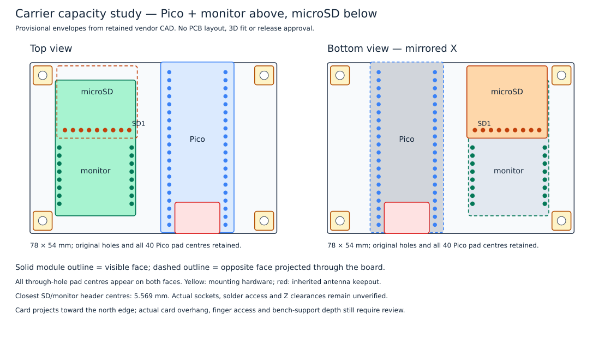

# Carrier module capacity study

Recorded 2026-10-16 after the owner approved Adafruit 4682 for storage. This is a **provisional geometric model**, separate from a KiCad layout and from physical mechanical validation. No schematic-completion or layout milestone is claimed.



## Result

Keep the existing 78 × 54 mm carrier outline, four mounting-hole centres and all 40 Pico header-pad centres. Retain the earlier front-side MikroE test position at (8, 5.5) mm and place the Adafruit microSD envelope on the **back** at projected top-view origin **(8.5, 1.0) mm**. The module's card opening faces the north edge for removal. This arrangement passes the checks on board envelopes and header-pad separation described below. It still requires socket, solder-tail, component-height, support and card-access review before implementation.

The one-face alternative does not fit in the conservative model with 0/90-degree orientations and nonoverlapping rectangular module envelopes. The fixed Pico courtyard leaves a 41.305 mm wide region on its left and a 13.525 mm region on its right. Both candidate modules are too wide for the right region. Side by side on the left they need at least 48.26 mm; stacked vertically they need at least 65.786 mm against 54 mm available. This is not a proof about arbitrary rotations, interlocking outlines or stacked modules. The underside arrangement avoids expanding the PCB in this model.

## Source geometry and checks

Inputs are the inherited [complete fixed-geometry inventory](../hardware/review/mikroe-4810-mechanical-study.json), verified against its source carrier SHA-256, the [monitor header table](../hardware/review/mikroe-4810-pinout.csv), and the retained [Adafruit Eagle board](../hardware/evidence/storage/adafruit-4682-source.brd). The study accounts for all **44 inherited pads/holes**, all **16 monitor header positions**, all **9 storage header positions**, four 6 mm mounting-hardware regions, the Pico courtyard and its antenna keepout. The full [model and coordinates](../hardware/review/carrier-module-envelope.json) record the inputs, assumptions and calculated results.

The Adafruit board's vendor coordinate system is a top view with Y increasing upward. Its source header is unrotated at vendor origin (12.7, 2.54) mm; the source outline spans X=0…25.4 and Y=0…22.86 mm. For the back-side candidate expressed in carrier top-view coordinates, use:

```text
x_carrier = 8.5 + 25.4 - x_vendor
y_carrier = 1.0 + 22.86 - y_vendor
```

The physical bottom-view panel additionally displays X as `78 - x_carrier`. This explicitly mirrors header order: storage pin 1 projects to **(31.36, 21.32)** mm in the carrier top view, while pin 9 projects to **(11.04, 21.32)** mm. The bottom-view drawing is an assembly-orientation illustration, not an approved socket pin map.

The minimum calculated storage-to-monitor header-centre distance is **5.569 mm**, between storage pin 1 and monitor pin 16. With hypothetical 2.00 mm copper-pad diameters, their edge gap would be **3.569 mm**. This checks only their proposed pad locations; actual pad shapes, socket bodies, tail lengths and solder access have not been qualified. Storage has a calculated **7.405 mm** gap to the inherited Pico courtyard and **1.5 mm** to the nearest inherited mounting-hardware rectangle. Its board envelope does not overlap the antenna region. Opposite-side module board projections overlap deliberately; this does not prove vertical clearance.

## Remaining mechanical conditions

The microSD header is soldered from the front, where its tails lie beneath the projected monitor board. Assemble and inspect those joints before plugging in the monitor. The monitor and Pico headers are soldered from the back; their joints must likewise remain accessible before plugging in storage. Sockets must permit removal without desoldering a module. These are proposed assembly sequences, not completed solder-access checks.

For the front stack, the monitor's underside clearance must exceed the storage-header tail projection plus any monitor underside protrusion, with an assembly margin. For the back stack, storage clearance must similarly account for other front-component tails projecting through the carrier. Exact socket/male-header part numbers, engagement and protrusion are not yet selected, so no numeric Z-clearance pass is asserted. Bench supports must extend below the populated underside; their final height depends on that stack. Do not treat a 3.5 mm bare-module product height as the whole installed height.

Reserve the actual inserted-card projection and finger/ejection space beyond the module's north edge; neither is numerically qualified here. Five LEDs, power distribution, decoupling and interface connectors are not placed in this study. It establishes a way to continue component qualification within the existing PCB geometry, not capacity for the entire finished carrier. The owner's previous hole/pin fit evidence remains valid within its existing scope and was not repeated.

The SVG was rendered with Inkscape and visually inspected. Native ERC, DRC, schematic parity and physical fit were not performed: no custom KiCad board exists. Future layout must recheck the saved footprints and populated stack rather than copying this model as a validated board.
