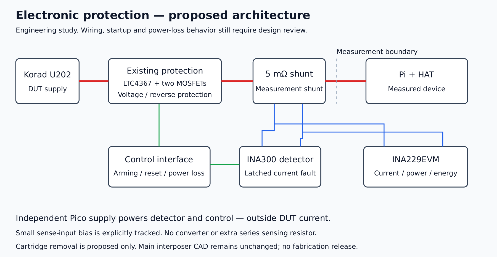

# Electronic protection study

The preferred direction to investigate is **a current detector controlling the existing power switches**. It avoids adding another resistance in the Pi supply path and retains the 5 mΩ measurement shunt. The user agreed to study an electronic replacement for the removable fuse. This study does not change the authoritative interposer or select parts for ordering.

## What the loss calculation now covers

The [six-branch copper budget](../hardware/review/copper-loop-budget.csv) includes the input, MOSFET interconnection, protected output, measured output and ground return. It gives **7.232 mΩ / 36.16 mV at 5 A** on a 0.10 mm calculation grid, with ideal parallel terminals. Added to component reference values, the cartridge design reaches **132.78 mV**, before holder/header contacts, further heating and assembly variation. This supersedes the earlier 118 mV subtotal, which included only one copper branch. These are computations, not physical measurements.

| Study option | Accounting reference at 5 A | Assessment |
|---|---:|---|
| Existing cartridge and holder | 132.8 mV before missing contributions | Does not demonstrate the 100 mV requirement |
| Replace cartridge with TPS25982 after existing protection | 98.8 mV using typical on-resistance; 107.8 mV using its hot maximum reference | Little margin; extra series switch and PCB work; not chosen |
| Remove cartridge; detect current on existing shunt and command existing switches | 85.3 mV before missing contributions | Preferred study direction; about 14.7 mV accounting headroom remains |

This is an accounting comparison on the existing copper. Removing the holder changes placement and routing; **85.3 mV is not a prediction of a new finished board**. Header resistance, hot MOSFET resistance and the new copper still need a complete budget.

The [TPS25982 datasheet](https://www.ti.com/lit/ds/symlink/tps25982.pdf), Rev. D, pp. 8–9, specifies 2.7 mΩ typical and 4.5 mΩ over its temperature range at a 2 A test current. Its 7.6 V OVP variant accommodates 5.1 V but cannot replace the existing Pi overvoltage protection. The resistance reference is not a validated 5 A result. TPS25984/TPS25990 were not selected: their published minimum current thresholds exceed this 5 A application's intended protection region.

## Proposed detector and control

The **INA300AIDGSR** candidate monitors the same Kelvin sense pair as the INA229EVM. It is a separate protection detector; the INA229 continues measuring current, power and energy. A 1.43 kΩ, 0.1% threshold resistor gives a nominal 5.62 A trip for the 10 µs setting, including TI's 500 µV noise adjustment. The initial tolerance screen is approximately **5.41–5.83 A**. Temperature, supply/common-mode effects and actual response remain unqualified. Its latched alert requires deliberate reset. [INA300 datasheet](https://www.ti.com/lit/ds/symlink/ina300.pdf), Rev. C, pp. 5, 12 and 18; the current addendum lists INA300AIDGSR active, while INA300AIDGST is obsolete.

Supply the detector from independent **Pico 3V3**, before and outside DUT current measurement. Its IN− input nevertheless introduces a small, explicitly identified measured-side bias: a 10 µA table reference is 0.01% of 100 mA. This is not a full-temperature or unpowered bound. Measure the additional bias and Kelvin wiring error; retain raw measurements rather than silently subtracting a constant.

**Do not wire ALERT straight to LTC4367 SHDN as a guaranteed interface.** Their published worst-case low-level figures meet at 0.4 V, leaving zero margin. A **SN74AUP1G17DBVR** buffer and SHDN pull-down are candidates for a defined low level and power-off behavior. Source conditions and the required loading checks are recorded in the [calculation artifact](../hardware/review/electronic-protection-study.json). The buffer is an active SOT-23 part, suitable for the selected factory SMT process; availability is not yet a quote. [TI buffer](https://www.ti.com/product/SN74AUP1G17/part-details/SN74AUP1G17DBVR).

SHDN uses the LTC4367's **slow** gate-discharge path. The fast UV/OV timing does not apply. Directly joining ALERT to UV would also introduce leakage into the precision divider, so that connection is not adopted. [LTC4367 datasheet](https://www.analog.com/media/en/technical-documentation/data-sheets/ltc4367.pdf), Rev. D, pp. 4 and 7.

## Requirements before drawing the new PCB

1. Define a hardware enable/brownout interlock: losing the Pico supply must disconnect the Pi, including the interval when INA300 supply drops below 2.7 V. A static power-off leakage calculation does not cover the transition.
2. Ensure the detector is ready before enabling the Pi. Define deliberate arming and latched-fault reset; resetting must not silently resume a recorded experiment. Cycling only the Korad does not necessarily clear a detector powered from the Pico.
3. Close the trip threshold and turn-off timing over actual operating conditions, including startup/inrush, gate capacitance and MOSFET SOA. Removing a thermal fuse changes the protection mechanism and its failure coverage; electronic shutdown is not a galvanic break or passive backup.
4. Complete sensing-input behavior with DUT off, reverse-input events and both power orders. Preserve Kelvin connections and the independent instrument supply boundary.
5. Capture a conventional-symbol schematic, export/check its netlist and review it before moving components or routing this topology. Recompute the full copper/contact/hot-device budget for that board.

The Korad's current limit remains essential. A detector set above 5 A cannot be assumed to trip on a short that the supply holds at 5 A. A threshold test will need a temporary lower threshold or a suitable isolated test fixture, with restoration recorded. UV shutdown and reconnection behavior must also be tested; the proposed current latch does not latch every voltage fault.

## Copper alternative already available for review

The [isolated KiCad candidate](../hardware/review/power-path-candidate.zip) adds measured-rail copper on both faces and stitching vias, with existing parts and pinout. Its [preview](../hardware/review/power-path-candidate.png) and [source binding](../hardware/review/power-path-candidate.json) are available. It passes native DRC/parity without exclusions being added. It is a comparison candidate, not the new electronic-protection board or a fabrication package.

A wider exploratory pour isolated a ground region and was rejected after DRC reported an unconnected item. That failure was retained in scratch evidence; no violation was suppressed. The accepted comparison uses the narrower corridor. The [whole-loop comparison](../hardware/review/power-path-candidate-copper.json) decreases calculated copper drop from 36.16 to 32.12 mV: only **4.03 mV** improvement. Its positive branch improves while its ground return worsens, so quoting the positive-branch improvement alone would overstate the benefit. The cartridge accounting subtotal remains 128.75 mV. The candidate is therefore not promoted as a solution to the target.

Reproduction: `make power-path-candidate`, `make copper-screen`, and `make electronic-protection-study`. The study exporter rejects stale main-PCB hashes and inconsistent branch totals before writing outputs. The candidate can be analyzed with `python3 scripts/screen-interposer-copper.py --board-dir .build/power-path-candidate/interposer --output hardware/review/power-path-candidate-copper.json`. No main-CAD change, ordering or energizing is performed by these targets. The [independent review record](../hardware/review/power-path-study-review.md) distinguishes arithmetic, native checks and still-open design requirements.
