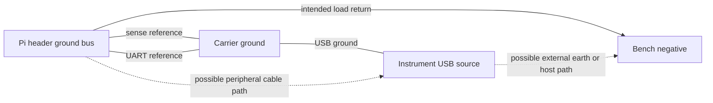

# Ground and reference connections

Date: 2026-10-16. Status: **partial topology review; intended external configuration confirmed by owner**. The owner specified: "Pico from a separate USB charger; Pi uses Wi-Fi only, occasionally IA Hat". Retain the approved non-isolated architecture and existing harness for this configuration. No isolation module or new ground component is selected. See [architecture](architecture.md), [sense interface](sense-interface-options.md) and [UART qualification](uart-interface-qualification.md).

The declared measurement setup has no Pi HDMI, wired Ethernet or external USB peripheral connection. An optional AI HAT powered from the Pi header is inside the DUT measurement boundary. Its exact variant, power entry, mechanical clearance and peak load still need verification; do not assume that an additional HAT supply is acceptable. Temporary computer USB or test-equipment connections introduce a different configuration and require the alternate-path review below. A separate charger is not by itself evidence of galvanic isolation or its output-to-earth behavior.

## Current paths to preserve

The intended load loop is bench positive → fuse → protection module → shunt → Pi 5 V pins → Pi ground pins → interposer power return → bench negative. The carrier receives its operating power and return through its own USB cable.

The sense-reference conductor and UART ground both connect the instrument reference to the DUT reference. For the implementation review, use a common interposer reference pickup at the DUT-header ground bus, with branches for both cable grounds. Keep the main load-current path out of these branches. On the carrier, both cable grounds, the monitor ground and the UART buffer ground belong to the instrument ground network. This is a routing intent, not an electrically isolated analog ground or a completed layout.

The two reference wires are parallel connections between the same intended endpoints. Their presence alone does not create a complete alternative bench-return loop. A loop can arise through a USB host, a peripheral, an earth connection, or reference pickups placed on opposite sides of a high-current return segment. Actual equipment and connections determine whether those paths exist. Do not infer isolation merely because the Pico has a separate power source.

## Consequences for measurement and faults

VBUS is measured relative to the monitor's ground. With `delta_G = V(Pi header ground) - V(carrier ground)`, the simple DC model is `reported VBUS = local Pi supply voltage + delta_G - sense-resistor drop`, before monitor error. A hypothetical 5 mV ground offset contributes 0.1% at 5 V. This is sensitivity arithmetic, not a measured offset or an allocated error budget. Load-dependent ground error cannot be removed by a single no-load calibration.

High-side current sensing does not by itself miss Pi current just because that current returns through another ground cable: the positive supply current still passes through the shunt. A second positive power source connected to the Pi is different and can bypass or contend with the measured supply. Keep that case distinct from alternate ground returns.

| Connection or fault | Finding | Evidence still needed |
|---|---|---|
| Only intended bench loop; USB source has no second conductive return | No complete external DUT-return loop is identified in this model | Actual supply/USB source connections and any earth bond; reference voltage under load |
| Pico connected to computer USB | Host ground could provide another path through other equipment | Host connections, bench-negative earth relationship and Pi peripherals |
| Pi connected to HDMI, USB or test equipment | Cable signal grounds or shields may create paths outside the interposer | Exact connected devices and their grounding; do not assume every shield or Ethernet interface has the same topology |
| Bench return opens | A remaining external path can carry load current through reference wiring; without a remaining path, the simple load loop opens | Trace each credible break location and all remaining connections; current limit setting is not a harness rating |
| One reference cable is disconnected | The other can still connect both grounds; signal pins may connect before reference during partial insertion | Connector sequence, receiver limits and waveform behavior |
| Both reference cables are disconnected | Analog/UART signals can remain connected without a controlled reference | Complete injection/common-mode analysis; do not rely on signal protection diodes as a return |
| Reversed bench input | Positive-path reverse protection does not prove that external ground paths are safe | Whole-system reversed-connection analysis |
| Devices off | Powered peripherals, USB hosts or stored charge can remain; fully disconnected, discharged devices have no sustained supply current in this model | Defined connection states; no claim that software shutdown removes power |

The three selected 82 Ω resistors protect only positive observation leads. They do not limit current in either reference wire. The 470 Ω UART series values also do not protect ground conductors. Do not add an arbitrary resistor, fuse or removable link in the shared reference without reviewing the resulting ground offset and the signal paths when it opens. Galvanic isolation would be a separate architecture/component choice; none is selected here.

## Next information and checks

The owner-confirmed configuration identifies no intentional external DUT return through a computer or wired peripheral. This supports retaining the existing topology for continued design; it does not establish physical fault survival. Record the actual USB charger, bench earth relationship and HAT variant before release. Continue with the common DUT-header reference pickup described above, without changing the inherited mechanics or adding a ground resistor.

Complete the interface fault and measurement-error review against that configuration and its credible connection changes. Future bench checks must distinguish unpowered continuity checks from powered voltage/current tests, with the latter requiring separate authorization and the applicable release checks. No hardware test, ground continuity measurement, schematic, ERC, DRC or parity check has been performed here.
