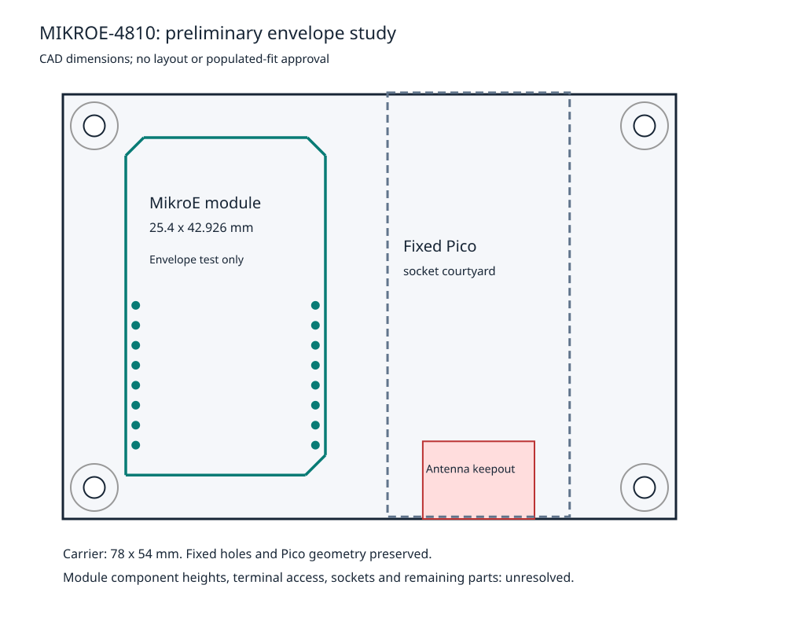

# MIKROE-4810 qualification

Date: 2026-10-15. Reviewer: Codex, documentary and calculated review. Owner decision: qualify MikroE I2C first. **Result: qualification report completed; module qualification remains partial. No unconditional selection, PCB implementation or hardware test is approved.**

## Result and evidence scope

| Finding | Result | Practical meaning |
|---|---|---|
| External Kelvin shunt and independent instrument power | Suitable in the documented topology | No onboard shunt needs removal; keep DUT current on the interposer |
| Standard header geometry | Suitable, documentary cross-check | All 16 positions agree between the vendor DXF and mikroBUS geometry; exact purchased sockets still need qualification |
| Module PCB outline versus inherited fixed geometry | Suitable for a preliminary envelope study | An outline can fit without moving the Pico/header or mounting holes; populated fit is not established |
| 5 V module logic connected directly to Pico | Unsuitable configuration | Use the factory 3.3 V selection and leave the 5 V supply contact disconnected |
| Triggered mode for the chip's accumulated energy | Unsuitable configuration | The device requires continuous conversion for valid elapsed-time accumulation |
| Current assembly/lifecycle evidence | Unverified | Published v100 schematic names an old ordering suffix; actual delivered assembly is not established |
| Complete carrier fit, socket solderability and all power states | Unverified | Requires remaining part/connector choices, electrical review and later authorized physical tests |
| Approximately 1% task-energy accuracy | Unverified | No shunt, calibration, operating envelope or timing validation is complete |

Detailed findings are in [the qualification checklist](../hardware/review/mikroe-4810-qualification.csv). It is a parts/module review, not a fabrication release checklist. Input hashes and derived-artifact hashes are recorded in `hardware/review/mikroe-4810-qualification-inputs.json`; a source change invalidates the associated findings until reviewed.

The controlling sources are retained in [the source manifest](../hardware/evidence/power-monitor/sources.csv): module schematic v100 (PM-S04), vendor CAD (PM-S06), mikroBUS v2.00 (PM-S07), Click guidelines April 2019 (PM-S08), and INA228 SLYS021A with its retrieved package addendum (PM-S01). The schematic and standard drawings received visual inspection after the session's successful image-read probe. Numeric curves were not read. The vendor STEP model has not received a complete 3D review.

## Connection contract

This is a qualification-level logical contract, not a completed schematic or approved harness. The [16-pin map](../hardware/review/mikroe-4810-pinout.csv) records every contact and its module-relative coordinate. It uses the top/component view, origin at the module board's upper-left, positive X right and positive Y down. DXF coordinates are converted explicitly as `x = x_vendor - min_x`, `y = max_y - y_vendor`; no additional horizontal mirror is applied. Numbering follows the manufacturer's logical mikroBUS table: left top-to-bottom 1–8; right bottom-to-top 9–16. A bottom view must be mirrored when later creating assembly instructions.

| Connection | Direction, domain and normal condition | Fault or unpowered constraint |
|---|---|---|
| Pin 7, INSTR_3V3 | Instrument supply into module; nominal 3.3 V, independent of DUT power | INA228 operating supply 2.7–5.5 V is a device range, not permission for 5 V Pico logic. Final rail tolerances and current budget remain open |
| Pins 8/9, INSTR_GND | Instrument reference and low-current module return | Intentionally reference DUT ground; prevent USB/sense conductors becoming the intended DUT power return. Never leave module ground disconnected while powered |
| Pin 10, 5 V | Not connected on this carrier | Keep disconnected; do not expose a second module supply or energize the wrong selector position |
| Pin 11, PM_SDA | Bidirectional I2C; open-drain bus with module pull-up to instrument 3.3 V | Keep within the selected rail and receiver limits; no external live pull-up when instrument power is off |
| Pin 12, PM_SCL | Pico clock to module; pulled up to instrument 3.3 V | Same ownership and power-off restrictions as SDA; waveform timing must be checked |
| Pin 15, PM_ALERT_N | Module open-drain status/conversion-ready output to Pico | Module pull-up uses instrument power. Keep Pico and monitor in the same intended logic-supply domain |
| Pins 1–6, 13/14, 16 | Unused on this module; leave unconnected | Do not inherit SPI/UART wiring from the old carrier |
| IN1, IN+ | High-impedance input from upstream Kelvin shunt terminal | Nominal common mode near the protected DUT supply; an input cable must not carry DUT load current |
| IN1, IN− | High-impedance input from downstream Kelvin shunt terminal | Same reference and fault review as IN+. Reversing the pair reverses current sign; a disconnected lead is invalid data |
| IN2, VBUS | Observe downstream header power bus; nominal near 5.1 V, referenced to module ground | Ground-reference, wiring/contact loss and finite input loading enter the error budget |
| IN2, GND | Module ground, directly common with header GND in v100 | Do not create an unintended parallel high-current return. Exact system ground topology remains open |

The physical top/bottom order of the IN1/IN2 terminal pairs still requires corroboration against the supplied module; the net names above do not authorize an unverified numbered cable pinout. Fault voltages, cable current limiting and contact order are not yet qualified. Device input ranges must not be mistaken for protection of the Pi or the complete harness.

MikroE's [published settings](https://www.mikroe.com/power-monitor-click) specify factory JP3 at 3.3 V and both address selectors toward SDA. With the address relation in SLYS021A table 7-2 this implies 7-bit address **0x4A**. Check the delivered settings without moving fine-pitch jumpers. If they differ, resolve the supply/address change before use; do not improvise rework.

For future bring-up, start with a short local 100 kHz bus and verify identity: MANUFACTURER_ID at 0x3E is 0x5449; DEVICE_ID at 0x3F has upper 12 bits 0x228, with its revision nibble recorded separately. Confirm the extra 100 ns address-MSB hold requirement when the address pins use SDA (SLYS021A section 7.5.1). Successful identification and bus waveforms remain bench tests, not current results.

## Onboard circuitry, loading and power states

The v100 schematic already contains a 100 nF supply bypass, 4.7 kΩ SDA/SCL pull-ups, 10 kΩ ALERT pull-up and a power LED with 470 Ω series resistor. Do not duplicate them automatically. Keep their power entirely in the instrument domain. Exact resistor tolerances, LED behavior and the carrier's available 3.3 V current remain open; no guaranteed module-current limit is established here.

Nominal calculations at 3.3 V give 0.617 mA per low I2C line at 0.4 V output-low. The module's onboard pull-ups are therefore compatible in scale with the INA228's documented 3 mA output-low test, but Pico sink capability and the total parallel pull-up network still need review. A 400 kHz bus has a 300 ns device rise-time limit; retain onboard pull-ups initially and qualify actual bus rise time before setting the final bus rate. I2C stays on the carrier; the 10–20 cm inter-board cable carries analog sense signals, not this I2C bus.

At 5.1 V, the device's specified 0.8–1.2 MΩ active VBUS input impedance corresponds to a **calculated 4.25–6.375 µA** load. The typical 92 kΩ differential input impedance gives approximately **0.272 µA at 25 mV**, a typical-only estimate. Those finite measurement-input loads must be included in the error budget. They are not a license to power indicators, dividers or other auxiliary circuitry after the shunt. Check powered-off leakage separately; shutdown mode is not the same as an absent supply.

| DUT supply | Instrument USB | Documentary assessment and remaining proof |
|---|---|---|
| Off | Off | No intended active source; independently powered peripherals and grounded USB connections remain system-level checks |
| On | Off | INA228 sections 7.3.1 and 9 permit monitored analog voltage while its supply is absent. This supports the topology; full module/harness loading and digital back-powering are unverified |
| Off | On | Module operating power and pull-ups come from instrument USB. Prove negligible unintended DUT injection and correct off/disconnected indication; no useful DUT energy is implied by a powered sensor |
| On | On | Normal intended state. Verify reference offset, valid configuration, conversion timing and calibrated scale |
| Either supply transitioning | Any | Ground continuity, shared-rail decay, brownout, resets and marker/UART interface behavior remain unverified; static datasheet statements do not prove transitions |

## Mechanical findings

The drawing is a geometric capacity study, not a PCB layout. Source CAD data and the full inherited fixed-pad/hole inventory are saved in [the mechanical study](../hardware/review/mikroe-4810-mechanical-study.json). The vendor DXF contains seven board-outline segments and all 16 header centres; their extracted envelope is **25.4 × 42.926 mm**, consistent with the manufacturer's rounded M size. Header pitch is **2.54 mm**, row spacing **22.86 mm**, and each row spans **17.78 mm**.

A test translation to (8, 5.5) mm on the inherited 78 × 54 mm carrier gives a calculated 7.905 mm horizontal gap to the existing Pico socket courtyard and at least 1.272 mm to the inherited 6 mm mounting-hardware envelopes. The module board does not overlap the inherited antenna region. Coordinates describe this test only; they are not approved component placement.

The study leaves module component overhang, screw-terminal access, cable bends, underside leads, socket bodies/heights and the rest of the new carrier unverified. Exact sockets are not selected; their maximum lead shape must fit the allowed finished holes and pad spacing with soldering-tip clearance. Do not transfer the module's own drill diameter into the carrier as a socket recommendation. The earlier owner's Pi/Pico fit evidence remains valid within its stated scope; no repeated unchanged mounting-fit test is demanded here. No inherited CAD file, outline, mounting hole or Pico header was changed.

## Accuracy and event-delimited acquisition

The owner intends LLM and image-recognition tasks and does not know their durations. Retain start/end markers and report energy, elapsed time and average power without prescribing a task length. Record idle/warm-up policy and included peripherals for each later experiment; do not silently subtract an idle baseline or average unrelated runs. For exceptionally short operations, a declared batch of completed tasks may be evaluated separately, with warm-up and task-count semantics recorded.

The [screening calculations](../hardware/review/mikroe-4810-calculations.csv) are not a complete error budget. At the unselected 5 mΩ reference and proposed 5 A, shunt drop is 25 mV, dissipation 0.125 W, and a ±40.96 mV input range represents nominal ±8.192 A. Actual overload, tolerance and temperature limits remain open. A 1 µV offset corresponds to 0.2 mA: 0.2% at 0.1 A, 0.04% at 0.5 A and 0.004% at 5 A. These offset-only examples use a datasheet term with specified test conditions; they are not guaranteed total error at our operating point.

An illustrative 0.5%-tolerance shunt and 0.5% timing term already consume 1% if their worst-case errors align, before voltage/current gain, offset, drift or boundary uncertainty. The shunt and actual integration method have not been selected. The approximately 1% complete-task target therefore requires calibration and a defined operating envelope; the chip's full-scale energy specification is not a system guarantee.

Use **continuous shunt-plus-bus conversion** for evaluation of the chip accumulator, with die-temperature conversion disabled, one-sample averaging and a nominal 540 µs per input. This is an evaluation condition, not final firmware: nominal pair period is 1.08 ms, approximately 926 pairs/s. The datasheet warns that triggered-mode energy accumulation is invalid. Firmware must read back configuration/calibration, verify new conversion status, retain timestamps and identify stale or mixed-cycle values; never treat repeated register reads as new samples.

Keep **TEMPCOMP disabled** as well: section 7.3.5 of SLYS021A bases automatic shunt correction on the INA228 die temperature. Our shunt is on a separate interposer 10–20 cm away, so monitor die temperature cannot be assumed to track it. The [MSR1 candidate qualification](msr1-qualification.md) records the installed-resistance calibration and thermal-error implications. That review does not finalize shunt selection or establish system accuracy.

For scale, a conservative boundary-only model with one 1.08 ms period of uncertainty at each end gives 2.16% of a constant-power 0.1 s task, 0.216% of 1 s, and 0.0216% of 10 s. This calculation is neither a measured latency nor a total error bound for variable-power AI workloads. Improve or characterize marker/conversion alignment before claiming short-task accuracy.

For subsequent firmware review, evaluate chip energy-counter differences against integration with the Pico timebase; do not silently interchange them because their clock/error terms differ. Continuous energy counters require overflow handling and must not be reset ambiguously during a task. Record MATHOF, ENERGYOF/CHARGEOF as applicable, conversion-ready status, resets, lost samples and storage failures. Buffer microSD writes so acquisition does not stall. Counter coherence, marker transport latency, buffer sizing, final sample rate and the calibration/reference equipment are unresolved.

## Remaining evidence and supplier question

The [MikroE product page](https://www.mikroe.com/power-monitor-click) and its [current product-development article](https://www.mikroe.com/blog/electronic-product-development) continue to present this module. They do not identify the exact ordering code fitted to a purchasable unit. INA228AIDGST in schematic v100 is an ordering/packaging-suffix issue; it is not evidence of a different die or a failed board. The retrieved TI addendum supports active GSR variants, but current assembly provenance still cannot be inferred. No obsolete bare IC is selected and no replacement work is proposed.

Prepared supplier question, **not sent**:

> For Power Monitor Click MIKROE-4810, what hardware revision is currently supplied, and which exact INA228 ordering code is used? Published schematic v100 names INA228AIDGST, while TI's current package information lists active INA228AIDGSR variants. Please provide the current schematic/BOM revision or confirm the approved replacement. Also confirm that the unit ships assembled with headers fitted, JP3 set to 3.3 V and address jumpers in their published default positions, without customer SMD rework. Please provide a current mechanical drawing including fitted terminal/header heights and overhang.

Public documentation review did not resolve that specific assembly question. No supplier contact, authentication, order, payment or upload was performed. Retain the module as **under qualification**, and do not create a selected BOM entry until the sourcing and integration gaps are resolved and the owner chooses it.

Future closure requires a source-grounded socket/connector review, full carrier power/reference/error budgets, populated mechanical review and separately authorized bench work: unpowered continuity and rail isolation first, instrument-only checks, then suitable dummy-load sensing/power-state/calibration tests before any Pi connection. These are future checks, not executed procedures. ERC, DRC and schematic parity were not run because this phase creates no KiCad design.
