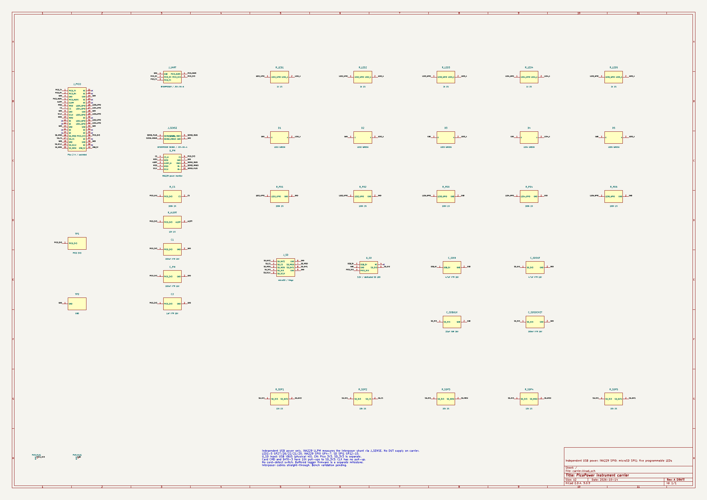
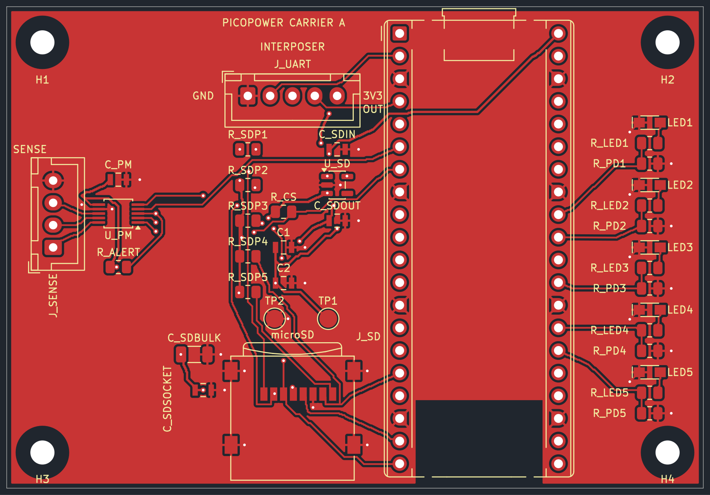

# PicoPower carrier — rev A engineering draft

This board sockets a Pico 2 W, provides five programmable green LEDs and a microSD slot, and carries the INA229 power monitor, fed from the interposer through a four-pin JST-XH sense connector. A five-pin JST-XH connector joins the carrier to the buffered Pi interposer. The carrier has its own USB-powered supply; instrument loads remain outside DUT energy measurements.

## Electrical schematic

This is the current KiCad schematic, including the five LED branches, INA229 and sense connector, UART connector, SPI1 microSD slot and dedicated card regulator. Matching net names are electrical connections. Click the PNG to read individual pin numbers and component values.

[Open full-size schematic PNG](schematic.png) · [Download schematic PDF](schematic.pdf).

## Front PCB layout

The sense connector and INA229 sit in a strip at the left edge, the Pico sockets in the middle, five LEDs along the right edge, and the hinged card socket in the lower-left. The UART JST-XH connector is above the microSD area. Four mounting holes provide support on a shared bench base.

[Open full-size PCB PNG](layout-front.png) · [Original front SVG](layout-front.svg).

## Review files

- [KiCad project](carrier.kicad_pro), [schematic](carrier.kicad_sch) and [routed PCB](carrier.kicad_pcb).
- [Schematic PDF](schematic.pdf), [front copper](layout-front.svg) and [back copper](layout-back.svg), viewed from above.
- [Mounting drawing](mounting.svg), [pinout](pinout.csv), [board BOM](board-bom.csv) and [circuit source](circuit.json).
- [Portable review archive](carrier-review.zip), including the local symbol and footprint libraries.
- [ERC](checks/erc.rpt), [DRC and schematic parity](checks/drc.rpt), and [source/PCB checks](checks/source-check.json).
- [PNG export provenance](images.json): source CAD hashes and image dimensions.

Open `carrier.kicad_pro` in KiCad 9. The schematic uses named nets: matching names are electrical connections. LED polarity is explicitly labelled A/K. `J_PICO` uses a combined socketed-Pico footprint; fit two 1x20 female strips at 17.78 mm row separation, with a compatible headered Pico. Its module/header height requires physical review.

`make carrier-build` deliberately overwrites carrier CAD and routes it again. Save interactive edits before using it. `make carrier-check`, `make carrier-erc` and `make carrier-drc` check the source/PCB mapping and native CAD. `make carrier-export` requires all checks to pass before exporting the review archive. Existing interposer build targets remain independent. These commands need KiCad 9, the distribution Python `pcbnew` module and NumPy.

## Electrical and mechanical choices

LED1-LED5 use GP27, GP26, GP22, GP21 and GP20 (physical pins 32, 31, 29, 27, 26), each with a 1 kOhm series resistor and a 100 kOhm GPIO pull-down. High turns an LED on; low turns it off. Firmware functions and PWM remain programmable. The [LED datasheet](https://www.kingbrightusa.com/images/catalog/spec/apt2012lzgck.pdf) gives typical Vf 2.65 V at 2 mA; using this voltage gives a 0.65 mA reference estimate per LED, not a solved operating point. Actual current and brightness remain bench checks. See the [current calculations](../../../docs/pico-carrier.md).

`J_UART` is JST B5B-XH-A(LF)(SN), with pins 1-5: GND, PICO_RX, PICO_TX, PICO_MARK, PICO_3V3. A straight-through five-wire harness uses XHP-5 housings at both ends and ten SXH-001T-P0.6 contacts. Pin 5 supplies the interposer buffer from the Pico. See the [wiring procedure](../../../docs/wiring.md).

`J_SENSE` is JST B4B-XH-A(LF)(SN), pins 1-4: SENSE_PLUS, SENSE_MINUS, SENSE_VBUS, GND, joined to interposer J3 with a straight-through XHP-4 cable. `U_PM` is the INA229AIDGSR (VSSOP-10): SPI0 on GP4-GP7 (physical 6, 7, 9, 10), ALERT on GP3, 100 nF bypass `C_PM`, a 100 kOhm CS pull-up and a 10 kOhm ALERT pull-up, all to PICO_3V3. Pin numbering follows TI SLYS023A table 5-1. The footprint is the KiCad VSSOP-10 snapshot; it has not yet been compared with TI's DGS0010A land pattern. The sense pair is fanned out from the 0.5 mm pins to J_SENSE; its Kelvin routing needs review.

J_SD uses a hinged Würth 693072010801 socket on SPI1 (GP12-GP15), separate from INA229 SPI0 (GP4-GP7). Five 10 kOhm pull-ups bias CMD/DAT0-DAT3. A TLV75533PDBVR supplies SD_3V3 from Pico USB VBUS, enabled by PICO_3V3, with 4.7 uF input/output capacitors and 22 uF/100 nF near the slot. The rails are not joined. The socket has no card-detect switch; recording requires future buffered logger firmware. See the [storage and power details](../../../docs/pico-carrier.md).

The board is 78 x 54 mm, 1.6 mm FR4, with two 35 um copper layers. Four 2.7 mm NPTH mounting holes at (4,4), (74,4), (4,50), (74,50) mm have 6 mm copper keepouts. Use M2.5 nylon hardware on a shared bench base and match board height without stressing connectors. The antenna has a copper keepout on both sides; keep base material, metal hardware and cables clear of the antenna region.

## Rebuilding the board

`make carrier-build` (generate, then the grid router) does **not currently reproduce this board**. On 2026-10-14, after the INA229 change, four regeneration attempts failed inside the router with "No route for ..." on different nets, including attempts in a scratch directory and with fixed hash seeds; the cause was not identified. The saved `carrier.kicad_pcb` (routed, with ERC, DRC and parity clean) is therefore the source of truth. Edit it in KiCad or with a targeted script that starts from the routed board, and do not run `make carrier-build` over it. A known-good copy of the routed board and its `circuit.json` is kept locally in `.build/carrier-good/`, which git ignores, so commit the board before experimenting.

## Release and physical acceptance

**Engineering draft, not fabrication-ready.** Automated reports describe CAD checks only. There are no released Gerbers, procurement actions or carrier firmware. Native footprints are snapshotted locally; the Sullins socket is a custom dimensional draft. Complete component/circuit/footprint/orientation review and physical mock-up before prototype fabrication; complete assembled-board electrical tests before DUT connection. The [CSV checklist](../../release-checklist.csv), [release procedure](../../../docs/release.md) and [current review findings](../../review/README.md) record both gates, which remain blocked.

KiCad 9.0.9 reports zero ERC violations, zero DRC violations, zero unconnected pads and zero schematic parity issues. Ten carrier regression tests cover connector mappings, LED GPIOs, separate SD power and SPI1 allocation; run them with the thirteen existing interposer tests. Re-run checks after edits; do not suppress violations to obtain a release.

With instrument and DUT supplies disabled, verify connector continuity, LED polarity and separation from DUT power. After electrical review, validate independent USB power and the INA229 3.3 V supply before attaching DUT sense wiring. Exercise all five LEDs individually, together and with PWM; check reset behavior. Validate SPI device identification, ALERT, UART and marker signals, then card write/read checks and supply stability with SD writes, Wi-Fi and all indicators active. Measure card current peaks and regulator temperature; the 500 mA regulator rating is not a board-level continuous-load guarantee. Follow the existing interposer power-off procedure. Firmware/test tooling for these bench exercises is a separate milestone.

Record actual module revisions, socket height, supply voltages, traces, equipment and results. A Linux shutdown alone is not proof that Pi 3.3 V is off. Physical acceptance remains **not performed**.
