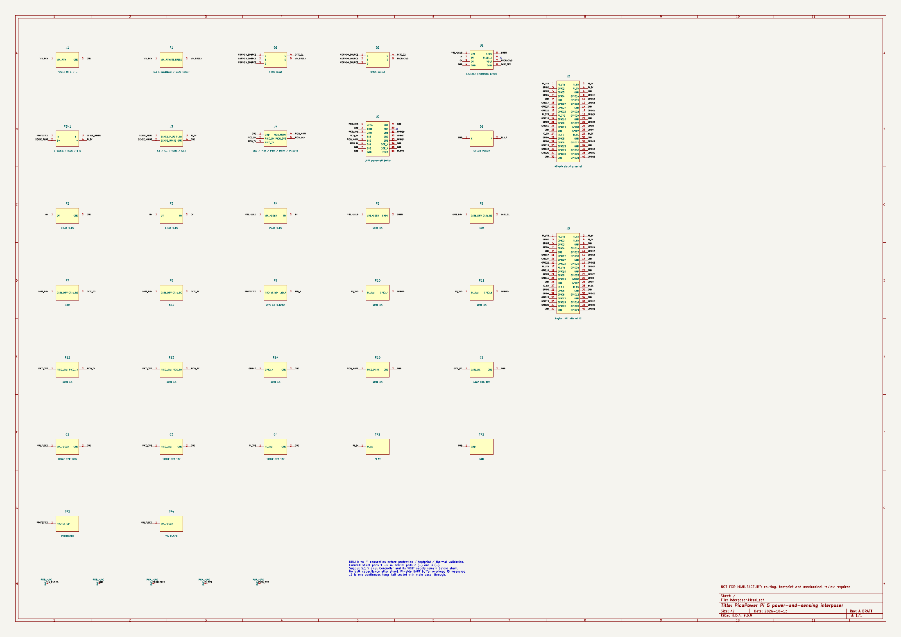
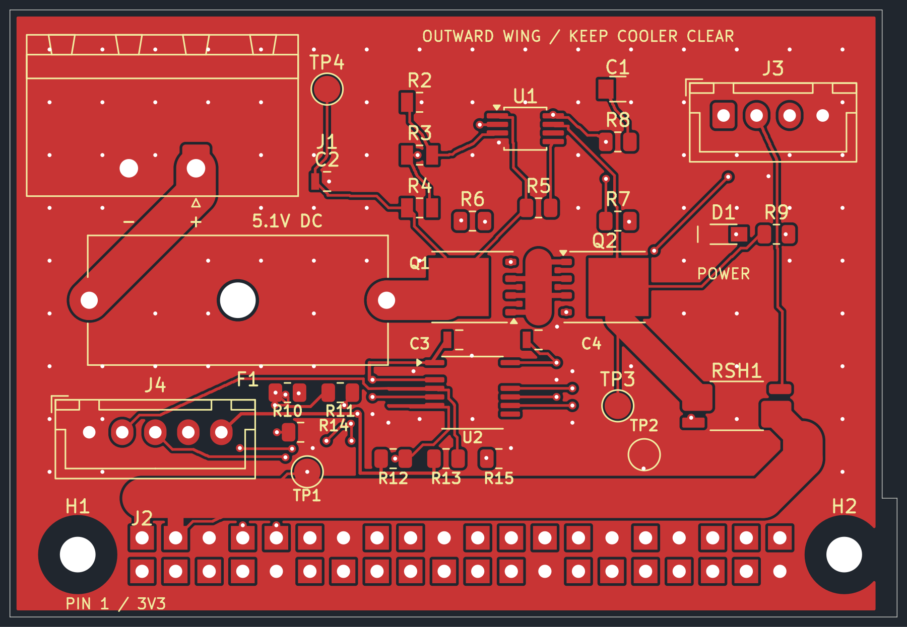

# Pi 5 power-and-sensing interposer — rev A draft

This package implements the agreed power entry, fuse, four-terminal shunt and HAT pass-through. The sensor and Pico stay off-board.

## Electrical schematic

The drawing below is exported from the current KiCad electrical schematic. Matching net names are electrical connections; the schematic uses named nets rather than long wires across the sheet. Click the PNG to inspect component labels and pin numbers at full resolution.

[Open full-size schematic PNG](schematic.png) · [Download schematic PDF](schematic.pdf).

## Front PCB layout

[Open full-size PCB PNG](layout-front.png) · [Original front SVG](layout-front.svg).

## Design files

- [Circuit source](circuit.json): pin-to-net mapping, parts, placement and electrical defaults.
- [KiCad schematic](interposer.kicad_sch): self-contained symbols; electrical connections use named nets.
- [KiCad PCB](interposer.kicad_pcb): routed two-layer review board, with explicit power paths and ground pours.
- [Project configuration](interposer.kicad_pro).
- [Electrical schematic PDF](schematic.pdf).
- [Power-path overview](schematic.svg).
- [Front copper preview](layout-front.svg) and [back copper preview](layout-back.svg), both viewed from above.
- [Portable review archive](interposer-review.zip).
- [ERC report](checks/erc.rpt), [DRC and schematic parity report](checks/drc.rpt), [source calculations](checks/source-check.json).
- [Mechanical placement preview](placement.svg).
- [Pin assignments](pinout.csv).
- [Board BOM](board-bom.csv).
- [PNG export provenance](images.json): source CAD hashes and image dimensions.

The complete generated board is reproducible with `make hardware-build`; this needs KiCad 9, its distribution Python module and NumPy. `make hardware-generate` alone resets it to an unrouted placement. `make hardware-export` runs checks and exports review artifacts. **Do not regenerate over hand-edited KiCad files without saving the edits.** The generator defines the circuit; native KiCad footprints are then placed, routing is generated, and net names are synchronized with the schematic. Before making interactive changes, preserve this generated version and use the KiCad files as the authoritative design. The exported placement diagram is a provisional geometry guide; use the copper previews for actual native footprints.

## Electrical choices

`J1 -> F1 -> Q1/Q2 -> RSH1 -> J2 pins 2/4` is the only positive DUT supply path. The eight Pi ground pins share the return. The socket and upper male pins are one continuous stacking connector, not two independently wired connectors.

- RSH1: Vishay WSK25125L000DEA, 5 mOhm, 0.5%, 1 W, four terminals. Pads 1/4 carry current; pads 2/3 are the Kelvin sense connections. No copper may bridge around the resistor.
- Protection: LTC4367IMS8#PBF and two source-to-source BSC010N04LS6 MOSFETs. All control supply, threshold divider and gate-slew circuitry is upstream of the shunt. This option is the recommended default from the pending protection preference; it can be revised before layout release.
- Divider: 95.3 kOhm from fused input to UV, 1.50 kOhm from UV to OV, 10.0 kOhm from OV to ground; all 0.1%. Nominal falling UV trip is 4.643 V, rising OV trip 5.340 V. Comparator tolerance, hysteresis and leakage must be included in the acceptance report. These are input-fault cutoffs, not precision output clamps or proof of the Pi's permissible voltage envelope.
- The controller's VOUT sensing is connected to PROTECTED, before the shunt, so its current is excluded from DUT current. An input-rated 100 nF capacitor is also before the shunt.
- R5 pulls SHDN up through 510 kOhm to limit reverse-input pin current. R6/R7 are 10 Ohm individual gate resistors. R8/C1 form the 5.1 kOhm / 12 nF gate slew branch recommended for review against the reference circuit and actual Pi inrush.
- F1: initial 6.3 A fast cartridge candidate in a Schurter OGN 0031.8201 holder. The fuse's DC suitability, cold resistance, power acceptance and time-current curve must be confirmed before release. With the Korad limited to 5 A, the fuse may never open during a short: supply current limiting is the primary bench short-circuit response. A fuse does not provide electronic current limiting.
- D1: Kingbright APT2012LZGCK low-current green 0805 LED, with R9 = 2.7 kOhm, 1%, at least 0.125 W. Branch: PROTECTED -> R9 -> D1 anode (pad 2); D1 cathode (pad 1) -> GND. It indicates voltage after the protection switches, before the shunt, so LED current is excluded from measured DUT current. Estimated nominal current is about 1 mA; brightness must be checked on the assembled board. It is not a Pi boot, workload or accurate voltage-valid indicator and may fade rather than switch sharply at low voltage.
- U2: TI SN74AXC4T245PWR, TSSOP-16, dual-supply fixed-direction UART/marker buffer. VCCA uses PICO_3V3 from J4 pin 5; VCCB uses PI_3V3. They share ground but never join their supply rails. C3/C4 are 100 nF X7R/16 V/0805 decouplers. R10-R15 are 100 kOhm/1%/0805, providing local UART idle-high and marker idle-low bias. Both banks are enabled; bank 1 DIR is low (Pi -> Pico), bank 2 DIR is high (Pico -> Pi). Unused input is grounded and unused output is unconnected.
- The buffer's Pi-side supply and bias consumption are an explicitly accepted instrumentation overhead **included** in measured DUT current. Characterize static and traffic-dependent energy; do not assume it is excluded or subtract a constant. Power-off isolation is designed for either rail below 100 mV; brownout/rail decay and both power orders still need bench validation. It is not galvanic isolation.
- J4 is a five-pin JST-XH UART connector, distinct from four-pin J3. [Wiring](../../../docs/wiring.md) defines the changed harness pinout and Pico 3V3 supply input. Four-pin UART harnesses cannot be reused.
- No resettable PTC or regulator is included.

## Mechanical choices

The main body is 66 x 46 mm, with a small right mounting extension giving a 67.13 x 46 mm envelope and a component-free header band; the populated side wing extends outward from the GPIO edge. All dimensions are provisional pending physical fit. No tall component is placed inside the Pi/cooler footprint in the intended orientation.

H1 and H2 are board-only 2.7 mm non-plated mounting holes for provisional M2.5 hardware. Their centers are (5.13, 41.27) and (63.13, 41.27) mm from the PCB top-left, 58 mm apart. Both have a 6 mm diameter keepout for tracks, vias and copper pours on both sides. They are intentionally absent from the electrical schematic and component BOM; the mounting hardware is covered by HW-028. The right edge extends locally to x=67.13 mm from y=37 to 46 mm, providing 4 mm from H2 center to the outside edge.

The header-to-hole offsets (-4.87, -1.27) and (53.13, -1.27) mm relative to J2 pin 1 are provisional mechanical geometry, cross-checked against the installed KiCad Raspberry Pi Zero socketed mounting-hole footprint and the 58 mm standard mounting spacing. This is not a measured Pi 5 fit. Verify center positions, full socket body, screw-head/washer diameters and spacer engagement on the actual Pi 5. Maximum planned hardware envelope is 6 mm diameter; larger washers require a new clearance review. Split lower/upper standoffs must match connector seating without PCB flex; retain strain relief on the power harness.

J2 is a Samtec SSQ-120-03-G-D candidate with 10 mm tails used as the upper male pass-through. Pins are 2.54 mm pitch. Verify socket mating depth, tail protrusion through the chosen 1.6 mm PCB, orientation and the AI HAT's mating socket. Samtec quotes 6.3 A per contact for an SSQ/TSW test pair; that is **not an all-contacts-loaded Pi-header guarantee**. Verify derating, sharing between the two positive contacts, contact resistance and temperature at 5 A.

J1 uses Phoenix Contact MSTB 2,5/2-GF-5,08 1776508 with screw-flanged mating plug 1777989. It is polarized and secured after wiring. Verify footprint dimensions and flange hardware from the current manufacturer drawing. Avoid generic unverified connector substitutions.

The side wing needs external support and cable strain relief: do not use the Pi header as the only mechanical support. A physical mock-up must establish spacer heights, cooler clearance and PCIe cable reach for AI HAT+ and AI HAT+ 2. The Raspberry Pi mechanical drawing is explicitly approximate and must not be used alone as production data.

## Release status

**Routed engineering draft, not fabrication-ready.** KiCad 9.0.9 reports zero ERC violations, zero DRC violations, zero unconnected pads and zero schematic parity issues. Thirteen source-invariant tests pass. These are automated design checks, not bench validation. There are no released Gerbers. Re-run `make hardware-export` after changes to update checks and previews.

The stackup records 1.6 mm total thickness with two 70 um copper layers. The local footprint snapshots come from the installed KiCad libraries; their [license](PicoPower.pretty/LICENSE.md) and provenance in `circuit.json` are retained. The custom stacking-header footprint remains subject to manufacturer and physical review.

The [CSV release checklist](../../release-checklist.csv) separates prototype fabrication checks from assembled-board validation before Pi connection. Fabrication requires circuit/footprint/power-budget/routing review, clean ERC/DRC, physical mock-up and manufacturing-package review. Connection additionally requires dummy-load thermal/drop, input-fault/inrush, interface and sensing validation. Read the [current review findings](../../review/README.md), [release procedure](../../../docs/release.md), [assembly procedure](../../../docs/assembly.md) and [acceptance protocols](../../../tests/README.md). Both gates remain blocked.
