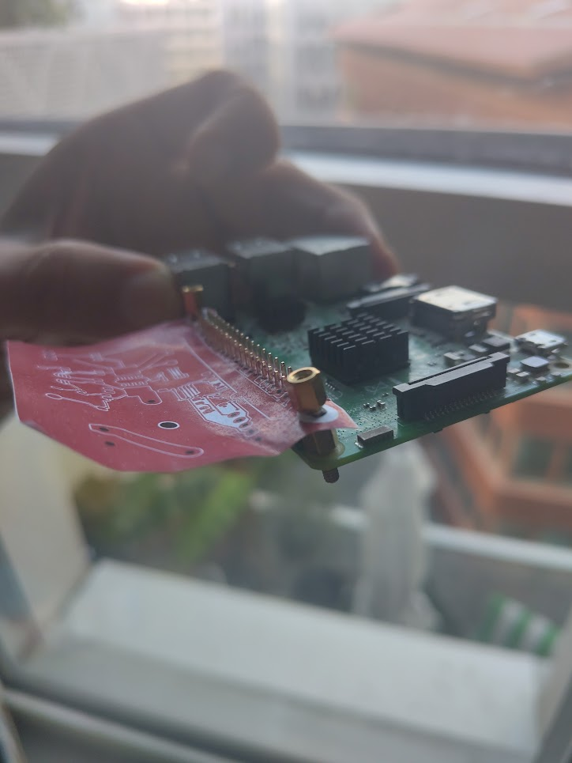
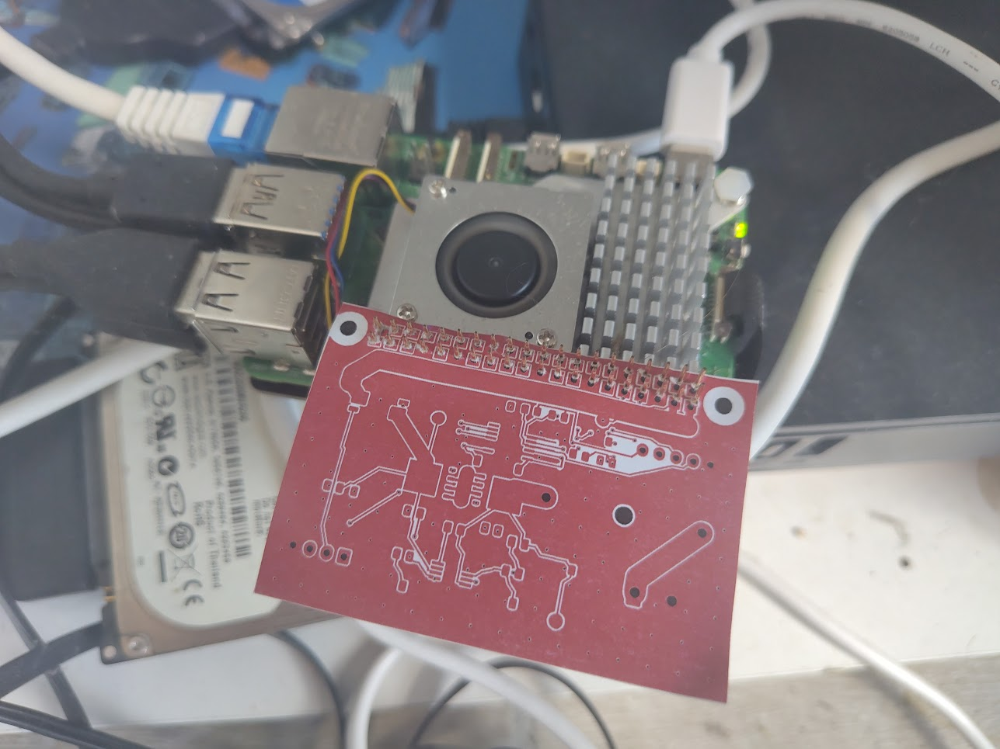
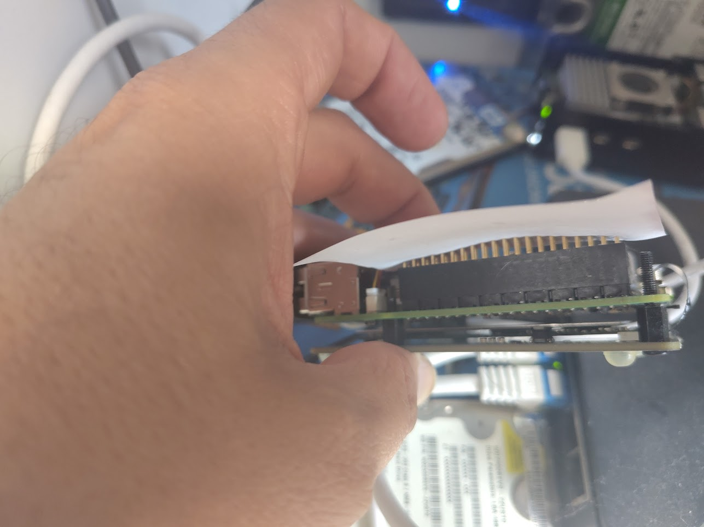
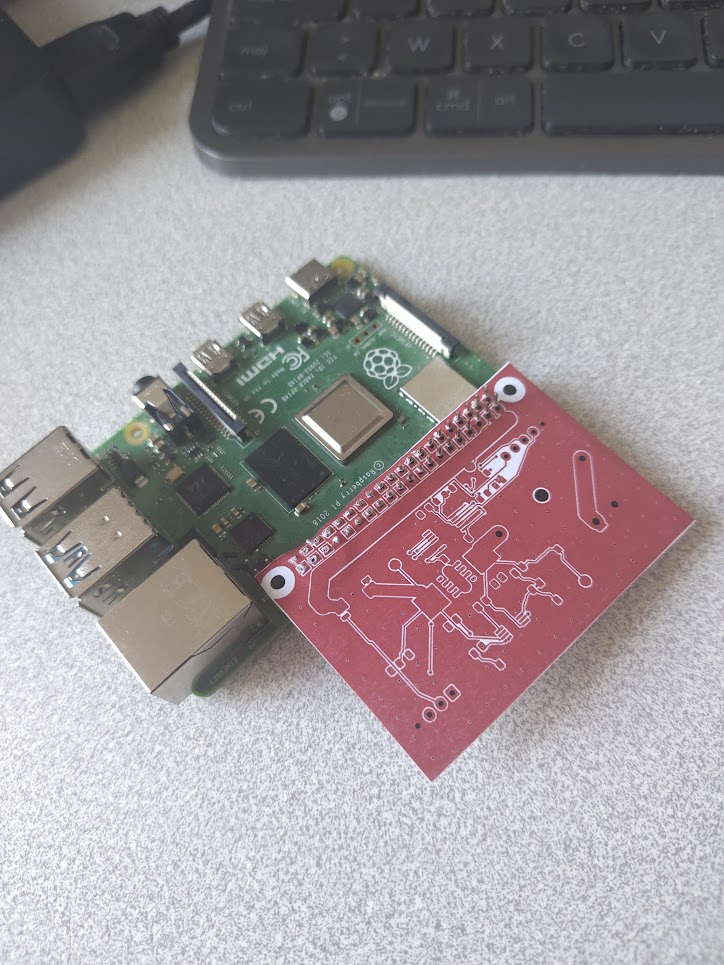
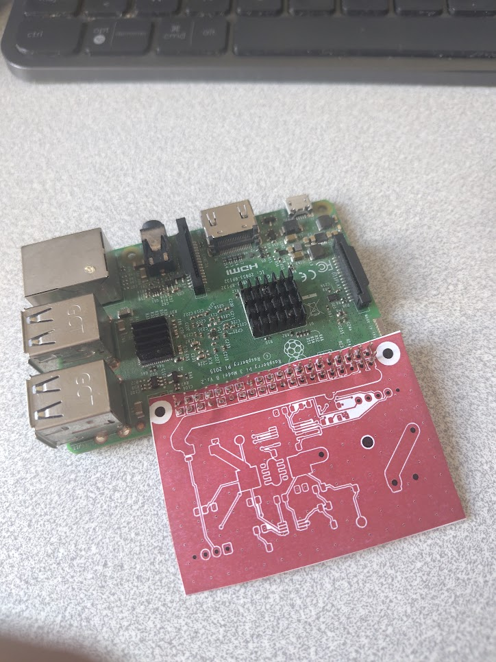
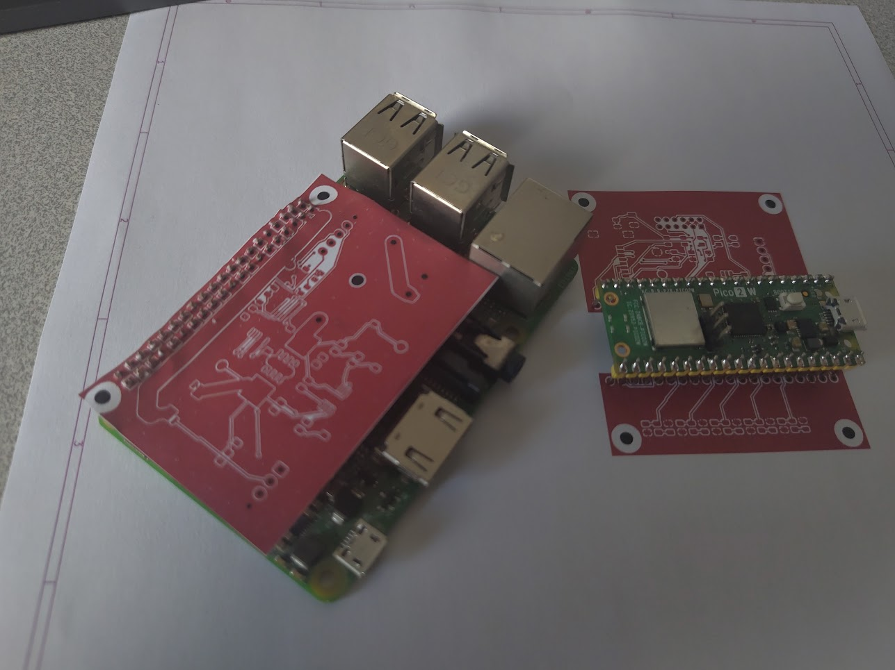

# Paper mock-up photographs

Evidence received on 2026-10-14: the user reports that the fit looks good and supplies [paper.jpg](../../img/paper.jpg).

The user subsequently corrected the interposer placement and supplied [wing.jpg](../../img/wing.jpg). This second image supersedes the initial interposer orientation observation.

The user confirms that the layout was printed **1:1** and supplies [pi4.jpg](../../img/pi4.jpg) showing the outward-wing placement on a Raspberry Pi 4. Print scale is recorded as user-confirmed; no numerical ruler measurement is inferred from the photographs.

The user subsequently supplies [pi5.jpg](../../img/pi5.jpg) and [pi5-2.jpg](../../img/pi5-2.jpg). They add Pi 5 paper-placement evidence with a fitted fan/heatsink and a side view of the header stack. The visible USB-C power lead and lit indicator mean these are not evidence of an unpowered fit procedure. Further positioning and connector checks must be performed with power and attached devices disconnected.

The [Pi 3 standoff photograph](../../img/pi3-with-standoffs.jpg) adds mounting evidence: a brass standoff is clearly visible through the near printed mounting location, beside the GPIO header, with the paper wing extending outward. The far mounting location is partly obscured. This supports preliminary mounting-location plausibility; the flexible sheet does not establish hole tolerances, rigid seating, screw-head clearance or absence of mechanical preload.

**The paper-placement stage is sufficient for preliminary review. No further paper-only photographs are required.** The remaining mechanical checks need the exact connector and rigid 1.6 mm geometry with representative component heights and the intended cooler/HAT assemblies.

These are user-supplied physical mock-up photographs. Observations below distinguish visual inspection and user confirmation from dimensional measurements or assembled-board acceptance.

| Item | Observation | Status |
|---|---|---|
| Interposer | Corrected paper layout shown on Pi 3, Pi 4 and Pi 5 | Partial paper-placement evidence on all three models |
| Interposer orientation | Corrected images show the populated area extending outside the GPIO edge, including Pi 5 | Outward placement observed; pin-1 mapping and exact connector engagement remain unverified |
| Pi identity | wing.jpg shows Pi 3 Model B V1.2 markings; subsequent photos are user-identified Pi 4 and Pi 5 | Pi 5 paper placement now documented |
| Print scaling | User explicitly confirms 1:1 printing | User-confirmed; no numerical measurement recorded |
| Mounting holes | Pi 3 standoff photo shows hardware through the near printed location alongside the aligned header; far location is partly obscured | Preliminary mounting-location evidence; rigid two-hole seating, hardware clearance and support not accepted |
| Header stack | pi5-2.jpg shows protruding header pins and a socket/header stack below the held paper | Exact part, seated 1.6 mm PCB height, mating depth and tail engagement not verified |
| Carrier | A headered Pico marked Pico 2 W is placed on the paper layout | Partial evidence |
| Pico sockets | Actual female socket strips and seated module height are not shown | Not verified |
| EVM / microSD | Actual mating EVM, socket and card/hinge are not shown | Not verified |
| Cooler | Pi 5 photos show a fitted fan/heatsink consistent with the intended Active Cooler arrangement; outward paper does not cover the visible fan opening | Partial visual evidence; component/solder/support clearance and airflow not measured |
| AI HATs | Neither AI HAT version is identified in the photos as fitted above the interposer | Both versions remain not tested |
| Power state | Pi 5 top view shows a connected USB-C lead and illuminated board indicator | Appears powered; not an unpowered-fit or power-up acceptance record |

Next mechanical stage: with power and attached devices disconnected, use the exact stacking connector and a rigid 1.6 mm mock-up to check pin 1, both mounting positions, seating and engagement. Add representative component heights to check cooler, support, both HAT versions and PCIe ribbon clearances. Use [mechanical requirements](../../docs/mechanical.md). Further progress on circuit, BOM and footprint review does not depend on more paper photos.

Both mechanical checklist entries remain partial. These photos do not complete either fabrication gate.
